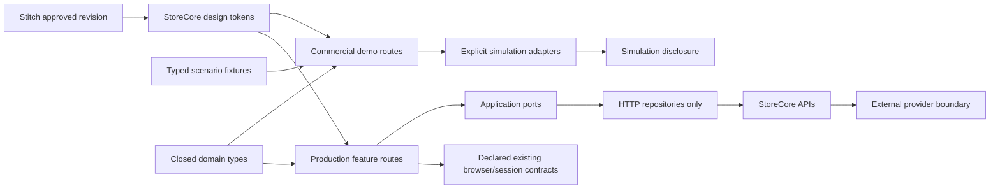

# Technical Specification — StoreCore commercial frontend completion

## Document status

- State: approved by the user; senior-review amendments incorporated before task generation.
- Platform: Angular 22 with a standalone demo and separate production feature routes.
- Source: `../1-functional/spec.md`.
- This document does not authorize code changes until the design gate is approved.

## Architecture context

Demo and production remain separate targets. Domain types, tokens, pure presenters and invariant policies may be reused; demo approval does not certify production HTTP behavior.

## Delivery-target matrix

Every surface record contains:

- `surfaceId`, route and permitted role/context;
- target: `Demo`, `Real` or `Both`;
- fixture/scenario and current closed state;
- visible actions and expected effects;
- persistence/reload expectation;
- design artifact revision;
- evidence paths and application commit;
- delivery level: `DesignApproved`, `DemoApproved`, `IntegrationReady`, `Integrated` or `Homologated`.

The versioned source of truth is `../1-functional/delivery-manifest.json`. It assigns all 26 surfaces to `Demo`, `Real` or `Both`, records the actual route on each target and separates demo-only behavior from productive behavior. Its `productiveBindings` identify component, use case, port file/method, repository and real action/effect only when those files and contracts exist in the reviewed SHA. A surface or action without an existing declared binding is demo-only. Favorites and offers remain Demo until their routes, ports and HTTP repositories are promoted in an owning code cut. Production routes retain their current HTTP repositories. The only non-HTTP productive exception is permission-derived navigation. Fixture repositories and simulation adapters are forbidden from the productive dependency graph.

Evidence navigation verifies both the final URL and the rendered surface identity. A wildcard redirect to Home never satisfies another surface. Current routes `/demo/recover`, `/demo/catalog/:sku` and `/demo/customer/register` remain stable unless a task explicitly supplies an alias, updates navigation/tests and proves continuity.

`DeliveryLevel.fromWire` maps unsupported values to `Unknown`. Labels and rules live in the type.

## Closed state model

Every finite domain is a TypeScript class with private constructor, static instances and one `fromWire` boundary translator. Unsupported values become fixed `Unknown`; arbitrary wire text is never rendered.

Required closed types:

- access context, role, session resolution and return destination;
- delivery level and simulation disclosure;
- product lifecycle, media kind, variant availability and stock severity;
- offer/campaign lifecycle;
- cart conflict and checkout step;
- delivery modality and payment method;
- payment, fulfillment and valid transition;
- incident, return and refund;
- alert audience, status, priority and target entity;
- capability/module state;
- marketplace connection, mapping, sync job and competition confidence/freshness;
- customer account and form/load state.

Checkout, fulfillment, post-sale and provider setup steps are objects with one responsibility. Adding a step does not rewrite previous steps.

## Design system contract

Stitch project `projects/6473866243657965808` and design system `assets/9094855779690782792` provide the foundation:

- StoreCore wordmark and rioplatense Spanish;
- light only;
- navy `#0f172a` structural chrome;
- blue `#1d4ed8` primary actions, links and focus;
- neutral canvas, white work surfaces and Inter typography;
- airy storefront and dense operator console using one token system.

The project currently has a design system but no screen instances. The design phase creates all 26 surfaces before implementation approval.

Forbidden claims: Mercado Libre branding imitation, provider logos in simulated flows, `FULL`, invented installments, fabricated reviews/sales, countdown urgency, visible internal store IDs, POS chrome and unqualified fiscal documents.

## Responsive component contract

### 390 pixels

- Public navigation collapses without hiding search/cart.
- Operator navigation uses an accessible task menu and visible current destination.
- Catalog uses a readable dense grid; secondary filters open in a focus-managed panel.
- Tables become labeled cards or controlled regions only with semantic equivalence.
- Checkout/backoffice use compact shells.
- Dialogs fit, scroll internally and keep actions visible.

### 768 pixels

- Catalog uses two/three columns based on real card width, never oversized single cards.
- Active filters remain visible outside the drawer.
- Operational collections use hybrid card/table layouts with explicit labels.
- Alert/summary panels do not displace primary work.

### 1440 pixels

- Content width supports scanning; operator tables avoid excessively wide text columns.
- Catalog uses three/four coherent cards per row.
- PDP keeps media, purchase decision and fulfillment assurance together.
- Dashboard/backoffice prioritize tasks over decorative whitespace.

## Component architecture

### Shared primitives

Semantic button, field, select, checkbox/radio, chip, badge, notice, tabs, pagination, dialog, empty/error state, money, date/time and status components. Labels derive from domain types.

### Storefront compositions

Global shell, search/category navigation, product card, filter summary, product decision panel, cart line, checkout progress, order summary, timeline and post-sale progress.

### Operator compositions

Operator shell, work queue, period metric, filter toolbar, responsive collection, entity summary, transition panel, inventory reconciliation, alert inbox and customer summary.

### Modal controller

One focus contract covers Product, Address, Campaign, Adjustment, Information, Confirm, Module, Tracking, Receipt, Incident, Return, Zoom and Reset. It owns naming, initial focus, trap, Escape, scroll and restoration.

### Responsibility extraction

- Each surface has a presenter/controller responsible only for deriving a view model and dispatching commands.
- Views render typed view models and emit typed intent; they never mutate `DemoSnapshot` directly.
- Commands call focused use cases and pure invariant policies. Persistence, navigation and notices are injected effects.
- `DemoCommerce` may remain as a compatibility facade only while it delegates to focused services; it cannot accumulate new business rules.
- Checkout, fulfillment, post-sale and provider setup steps are registered objects with one responsibility, rather than branches inside a monolithic component.

## Typed demo snapshot

Persistence pipeline:

1. Parse untrusted JSON.
2. Decode each finite value through its translator.
3. Validate cross-entity invariants.
4. Reject or explicitly migrate incompatible snapshots.
5. Persist the validated candidate successfully.
6. Publish the new in-memory state and success notice only after persistence succeeds.

Every mutation is transactional: command -> candidate snapshot -> decode/validate through the same codec and policies -> persist -> publish. Decoder rejection, storage/quota failure or cross-tab conflict preserves the previous valid state and emits no success notice. Corrupt persisted state enters an explicit recovery path; it is never silently replaced while reporting success.

Product save and decode use the same validator:

- at least one media and one valid active catalog variant;
- an active catalog variant may have zero sellable availability; a product with all variants disabled is invalid;
- archiving a variant preserves its stock and history;
- non-negative money;
- per variant, `originalListPrice >= currentBasePrice` before promotions; `effectivePrice` is derived and never participates in this validation. Command and decoder share the same policy. Base 100 + offer 20% + original 90 is rejected without mutation;
- aggregate display price derives from valid active catalog variants, including an exhausted active variant; availability is rendered independently. Physical stock aggregates all variants, including disabled ones;
- referenced category/campaign/offer exists.

Success feedback occurs only after validation and successful persistence.

## Commercial invariants

- Order chronology uses authoritative timestamp.
- A payment policy controls fulfillment eligibility.
- Cancelled/rejected payment cannot coexist with preparation/shipping/ready pickup.
- Pickup has no postal tracking.
- Customer alerts contain customer-safe payment/order/post-sale subjects only.
- Operator alerts navigate to the correct entity and preserve resolution history.
- Per variant, `physical`, `reserved` and `notSellable` are non-negative integers; reserved and not-sellable units are disjoint and `reserved + notSellable <= physical`. Impossible balances are rejected, never hidden by clamping. For an active variant, `sellable = physical - reserved - notSellable`; inactive variants contribute zero sellable but retain physical/history visibility. Deactivation is blocked while active reservations exist. A damaged return increases physical and not-sellable together in one transaction. Marketplace desired/observed quantities remain separate.
- Dashboard metrics derive from fixture orders and an explicit period.
- Paused/unavailable modules fail before irreversible confirmation.

### Operator authority and productive-field boundary

- `SC-SURF-16..18` permit Admin and Operator. `SC-SURF-19` permits Admin only; Operator renders access denied and cannot infer hidden campaign data.
- `SC-SURF-20..23` permit Admin and Operator. Unknown/unsupported roles deny every mutation and render access denied without leaking hidden data.
- Content save persists `HomeContentDraft`; it is not a publish command. Real renders only `title`, `body` and `blocks { id, title, body }`. Enriched merchandising controls are Demo-only.
- Product Real uses the existing product administration port. Original-list price, variant activation and Outlet unit/lot commands remain Demo-only until productive contracts exist.
- Offers are Demo-only in the reviewed SHA. Real read/write behavior remains deferred until an owning cut promotes a route, closed lifecycle type, application port, HTTP repository, backend contract and tests.
- Campaign Real is the existing `ManualPromo` by single SKU. Multi-product scope, audience, creative, communications and enriched status transitions are Demo-only.
- Entity lifecycle and form/load state are separate closed types. Views never encode `saving`, `invalid` or `failure` as offer/campaign lifecycle values.

### SC-SURF-20..23 target capability matrix

- `SC-SURF-20` Demo may filter the correlated queue and execute only the documented single-order transition. Real may `listAdmin`, `advanceShipment` and `advanceRma`; its read model has no buyer, contact, timestamp, modality, address or timeline, so the presenter exposes explicit absence rather than synthetic values. Export is a Demo information artifact and never fiscal or a bulk mutation.
- `SC-SURF-21` Real may `readAdmin`, then send shipment commands `PACKED`, `SHIPPED`, `DELIVERED` and the RMA command `RECEIVED` only when the closed domain policy permits them. `SHIPPED` requires tracking; the other shipment commands reject a submitted tracking value, while `DELIVERED` preserves the stored code when one exists. `READY_PICKUP` is outside the current closed frontend type and the unique boundary translator maps it to `Unknown`, which blocks mutation. Cancelled/rejected payment, stock review and Unknown block logistics. The current Real RMA contract is whole-order and cannot promise inspection, adjustment, partial quantities, damaged disposition or refund.
- `SC-SURF-22` Real may only `listInventory`. Its `availableQuantity` is the authoritative net available read model; `reservedQuantity` and `safetyStock` are separate facts. No physical/not-sellable derivation and no adjustment/reconciliation CTA is rendered on Real. Demo adjustment/reconciliation is transactional, validates integers and invariants, preserves a rejected proposal and is idempotent by operation ID.
- `SC-SURF-23` Real may `readMercadoLibreAccount`, `listMercadoLibreListings` and `saveMercadoLibreListing`. Mapping requires explicit validated numeric `accountId`; the current contract does not supply an account-list selector and `accountRef` is not a replacement. OAuth, connect/disconnect, publication mutation, job retry, provider activity and competition/repricing stay Demo/deferred.
- Every action is a typed object containing role, target, precondition, command, success state, recoverable failure and unavailable alternative. Views ask the object whether it is allowed and use its label; they do not reproduce state switches or magic strings.

Real shipment transitions are closed and exact: `NOT_CREATED` or `PENDING` with the server-provided eligible `PACKED` action --`PACKED`--> `PREPARING`; `PREPARING` with the server-provided eligible `SHIPPED` action and non-empty tracking --`SHIPPED`--> `SHIPPED`; `SHIPPED` with the server-provided eligible `DELIVERED` action --`DELIVERED`--> `DELIVERED`. Payment, order status, `fulfillmentEligibility` and `shipmentAction` are authoritative together; the client never infers eligibility from approved payment alone. Pending/rejected/cancelled/charged-back payment, stock review, cancelled/delivered/Unknown shipment block mutation. `READY_PICKUP` is not in the current closed productive type, translates to `Unknown` at the wire boundary and cannot mutate.

The Real RMA transition is closed and whole-order only and follows the productive service contract: `NONE` --`RECEIVED`--> `RETURN_RECEIVED`. Null or any unknown wire becomes `Unknown` at the boundary and blocks mutation. Every existing return state, including `RETURN_RECEIVED`, blocks another Real mutation because the current endpoint only creates the initial receipt. Inspection, adjustment and closure remain future contracts and must not be simulated by the Real UI. The server response, not an optimistic UI string, supplies the resulting state.

`design-manifest.json.targetApplicability` is authoritative for the design/evidence expansion of SC-SURF-20..23. It maps every state, dialog, tab and action to Demo or Real and requires an explicit unavailable-capability alternative instead of expanding forbidden Demo controls into Real.

### SC-SURF-24..26 authority and target matrix

- `SC-SURF-24` reads capabilities for Admin and Operator through the existing frontend binding. Productive mutation is deferred: the current frontend port lacks the reasoned/versioned command and `capabilityCommandStatus` reconciliation required by this design. The future owning cut must promote those port/repository extensions and tests before exposing the Admin CTA. The closed productive operational state is `CapabilityModuleState` (`DISABLED`, `READ_ONLY`, `ACTIVE`, `PAUSED`, `ERROR`, `Unknown`); availability and delivery level are separate closed presentation types. Future modules without a productive `CapabilityModuleId` are informational only.
- `SC-SURF-25` is Admin-only. Real accepts the server profile schema: `universal-tools-profile`, `1.0.0`, compatibility `1.x`, `content.homeSections` and non-empty `mergeSelection.homeSections`. Preview and merge send the exact same locally retained manifest text; editing or selecting invalidates the preview. No server preview ID, hash, CAS or idempotency guarantee exists. The presenter translates the server diff into closed `ADD`, `UPDATE`, `UNCHANGED`, `Unknown` values. General settings, export and reset are Demo-only typed commands with an explicit field allowlist and deterministic before/after snapshots.
- `SC-SURF-26` is Demo-only. Admin and Operator read; Admin alone writes account state. `CustomerAccountState` is `ACTIVE`, `RESTRICTED`, `Unknown`. The restriction command is idempotent and owns its effect on Demo session/login/checkout; order/refund/return aggregates are never mutated. The fixture joins `customer-2209` to `ORD-1015` by ID rather than inferred name or email.
- `design-manifest.json.targetApplicability` is authoritative for SC-SURF-24..26 as well. Views use typed action objects for role, target, preconditions and unavailable alternatives; they do not branch on raw strings.

### Canonical operational ledger

The design and Demo use one immutable cross-surface ledger. SC-SURF-15 remains composition/navigation evidence; it cannot override ledger numbers. SC-SURF-14/21 `ORD-1007` is a historical snapshot dated `2025-02-18`: pickup, simulated approved payment, `DEMO-001/kit-completo` `$198.800 ARS` plus `LUM-042` `$84.500 ARS`, total `$283.300 ARS`. Historical pickup does not enable current pickup.

The current baseline is `DEMO-001/kit-completo` `$198.800 ARS`, physical seven, reserved two, not-sellable zero, sellable five, no pickup; `DEMO-001/bare-tool` `$124.000 ARS`, physical/reserved/not-sellable/sellable zero; `LUM-042` `$84.500 ARS`, physical five, reserved one, not-sellable zero, sellable four; Outlet `VLD-043` physical one, reserved zero, not-sellable one, sellable zero; archived `LMP-044` `$62.300 ARS`, physical two, reserved/not-sellable zero and sellable zero. The twelve Demo orders and deterministic before/after specimens are enumerated in `design-manifest.json.operationalLedger`; reservations, movements, incidents, returns, listings and sync jobs reference those exact SKU/variant identities and preserve historical line prices.

Demo return intake, inspection, sellable restock, damaged/not-sellable disposition and refund are distinct idempotent operations. A quantity can be consumed once. Partial refund uses a separate closed `RefundStatus.PartiallyRefunded`; it does not mislabel the whole payment as `PaymentStatus.Refunded`. Demo sync stores desired, queued, sent, observed/confirmed/rejected and superseded event order separately; late events cannot overwrite the latest intent. Competition approval stores a human decision/evidence only, never a provider mutation or automatic repricing.

### Deterministic commercial evaluation

The Demo target uses reference instant `2026-10-15T12:00:00-03:00` in `America/Argentina/Buenos_Aires`. Lifecycle projections and previews are pure functions of that clock.

The commercial fixture is immutable across approved surfaces: `DEMO-001/kit-completo` currently applies `$198.800 ARS`, exposes five sellable units and has no pickup configuration; `bare-tool` applies `$124.000 ARS`. `OFF-DEMO-001` is scheduled and projects `$159.040 ARS` without changing current price. `VLD-043` uses Outlet base/current `$71.900 ARS` and original/comparator `$95.000 ARS`, with no promotion. Alternative state specimens must be explicitly isolated and cannot silently replace these values.

An offer is eligible only with a valid interval, applicable SKU, complete/evaluable price inputs and satisfied floor/margin policy. Eligible offers never stack. Selection order is numeric priority descending, valid discount descending, `startsAt` descending, then stable ID ascending. Missing margin or floor inputs produce `NotEvaluable`, never a computed success.

Manual campaigns/promotions are a separate approval/merchandising record and never add a second discount to the storefront offer. Each preview names the single price source. An incomplete product cannot be persisted because there is no draft contract; its values remain in the form after validation or persistence failure.

## Authentication and intent

`ReturnDestination` is an allowlisted closed type. Purchase intent stores product, variant, quantity and safe route through login, registration and recovery. It cannot carry arbitrary URLs or cross-realm authority.

Ambiguous valid credentials receive a short-lived opaque challenge. Customer and user sessions, CSRF ownership, roles and guards remain separate.

### Canonical demo customer contract

The design prototype and Demo target share one versioned wire contract across login, registration, profile, addresses, favorites, cart and checkout. Components never decode these values independently.

- Session key: `storecore_customer_session`.
- Canonical session wire: `{ "version": 1, "realm": "CUSTOMER", "state": "AUTHENTICATED", "actorId": string }`.
- `CustomerSession.fromWire` is the only boundary translator and accepts only the canonical versioned wire. SC-SURF-02 is revised with the rest of the identity/account batch to emit that contract. Missing, legacy, malformed and every other value become `Unknown` and deny access; there is no implicit migration inside a screen.
- The Demo target uses `sessionStorage` consistently for every key in this contract. The Real target never uses browser storage as authority. A surface cannot substitute `localStorage`, an in-memory authenticated fallback or a second logout flag.
- Logout removes only the customer session key, verifies absence and leaves customer screens anonymous. A fixture may be selected explicitly by a design/evidence scenario, but a runtime screen never creates an authenticated session because storage is absent.
- Profile key: `storecore_demo_customer_profile`, with `{ id, firstName, lastName, email, phone }` decoded through one codec.
- Addresses key: `storecore_demo_addresses`; favorites key: `storecore_demo_favorites` containing canonical product-id references only; cart key: `storecore_demo_cart` containing `{ productId, variantId, quantity, unitPrice }` lines only.
- There are no `_v1` aliases, per-screen stores or recoverable credentials. Password input, Base64, hashes and samples are never persisted by the prototype.
- `ReturnDestination.fromWire` owns the allowlist and opaque reference resolution for `returnRef`/`returnUrl`, including product, variant and quantity. Registration, profile and login preserve the typed destination until one explicit resume action consumes it; raw query strings never authorize navigation. Demo destinations remain under `/demo/**`; Real destinations remain under their productive routes and the two targets never cross-navigate.
- Every demo mutation captures all required snapshots before its first write, validates and persists the full candidate, verifies deep-equal readback and publishes only that verified candidate. Rollback restores and verifies every touched key even when one restoration fails.

### Design-tool responsibility boundary

Stitch artifacts are visual specifications, not executable domain prototypes. They define composition, hierarchy, responsive intent, content, control affordances and visible state variants. Their HTML must not implement or simulate authentication, authorization, browser persistence, checkout transactions, rollback, return-destination resolution or domain state machines.

- Stitch evidence contains semantic HTML/CSS and static, explicitly named visual states only. It contains no `localStorage`, `sessionStorage`, credential/session bootstrap, opaque-reference store, cart mutation or business-rule JavaScript.
- A visual fixture may render an authenticated, populated, empty, error or denied state, but it does not create authority or claim that an action succeeded.
- Dialog, focus, keyboard, reflow and live-region behavior is specified in the manifest and verified in the Angular implementation; Stitch may show their visual states but its generated scripts are never implementation evidence.
- The Angular Demo target is the first executable source of truth for the canonical session, typed state objects, codecs, transactions and navigation described above. Its tests, not generated Stitch JavaScript, close those behavior gates.
- Reviewers reject a Stitch artifact when its visual/content contract is incomplete or when it exposes technical controls/copy. Generated application-state JavaScript is removed rather than repaired or imported.

## Provider simulation boundaries

Each provider panel uses a port plus either:

- simulation adapter: deterministic fixture, persistent “Simulación” disclosure, no provider claim;
- real adapter: HTTP repository returning authoritative backend state.

UI never infers success from redirect, QR creation, local timer or optimistic intent.

### Mercado Pago and QR

Model order pending, QR created, expired, provider pending, approved, rejected, cancelled, refunded and reconciliation-required. Server confirmation is authoritative when integrated.

### ARCA

Model fiscal data missing, eligible, queued, authorized, rejected and uncertain in customer/admin order detail receipt-status panels. Payment approval and fiscal authorization are separate. This feature references the deferred fiscal contract and uses non-fiscal demo artifacts only; it creates no real issuance task.

### Mercado Libre

Separate desired, queued, sent, observed, confirmed, rejected, stale and conflicting values. Represent listing/variant mapping, authorization expiry and replay/out-of-order events.

### Competition

Store stable seller identity, normalized product identity, candidate listing and confidence evidence. Pricing never exceeds margin/threshold policy; uncertain matches require human review; freshness is visible.

### Shipping

Model destination validation/coverage/quote in checkout and label/tracking/incident/delivery in customer/admin order detail. A map/address acceptance is not a delivery guarantee. Target is demo until the dedicated carrier integration is ready.

### Outlet

Use catalog condition filter/collection, product-detail condition presentation, product-admin unit/lot editing and inventory reconciliation. Store condition, real media, defects, warranty terms and separate availability per unit/lot. Outlet is not a boolean tag on generic stock. Target is demo/integration-ready only in this cut.

## Design decisions

### DD-01 — Reopen the existing feature

Iterate this WIP and supersede prior completion claims, preserving audit history and avoiding competing specs.

### DD-02 — Design gate before code

Stitch prototypes and complete state inventory require UI, UX and Product Owner APPROVE before source changes.

### DD-03 — Second gate on executable Angular

The same reviewers repeat assessment on actual flows/screenshots. Prototype approval does not certify code.

### DD-04 — Demo and real targets stay distinct

Each acceptance criterion declares demo, real or both. Shared design does not collapse authority/data boundaries.

### DD-05 — Closed finite domains

All finite values use closed classes plus `fromWire`/`Unknown`; views/stores/tests avoid magic strings.

### DD-06 — Honest simulation

Mock adapters are allowed only with persistent disclosure and no homologation language.

### DD-07 — Manifest-driven evidence

Route/action/state manifest drives execution and capture. Screenshot count alone does not prove interaction coverage.

### DD-08 — Requirement precedence

- Simple product means one valid active catalog variant (including zero availability) plus one media item, superseding older two-variant requirements.
- The current StoreCore Stitch system supersedes older visual tokens for these 26 targets.
- Demo capability states map to productive closed types; demo-only scenarios remain local presentation states and never become wire values.
- Real ARCA issuance and real competition automation remain deferred by `sdd/PROJECT.md` and their dedicated specs.

### DD-09 — Future-module ownership

- Mercado Pago/QR/wallets: checkout, checkout result and order detail.
- ARCA: customer/admin order detail non-fiscal receipt/status panels.
- Advanced shipping: checkout and customer/admin order detail.
- Outlet: catalog, PDP, product administration and inventory.
- Competition: Mercado Libre operations.

Capabilities links to these surfaces and shows delivery level; it does not duplicate their operational UI.

### DD-10 — Manifest controls productive scope

`delivery-manifest.json` is the authoritative assignment of demo and productive behavior. Productive work is limited to existing routes, ports and HTTP contracts identified there. Missing backend capability remains an honest demo state and does not justify a fixture adapter in production.

### DD-11 — SOLID extraction before surface expansion

The current demo facade/component are migration sources, not target architecture. New work first extracts typed presenters, focused use cases, pure policies and step objects; subsequent surfaces compose those units instead of enlarging a monolith.

## Implementation sequence

1. Preserve reproductions for eight blocking P1/P2 cases.
2. Repair state contracts and domain invariants.
3. Implement tokens, primitives, shells and responsive collections.
4. Implement discovery and product-decision surfaces.
5. Implement identity, cart, checkout, result and order/post-sale flows.
6. Implement dashboard, customers, catalog, campaigns, orders and inventory.
7. Implement future-module simulations with honest boundary states.
8. Implement empty/error/Unknown/access/404 and all dialog states.
9. Add production-route parity only for the `realScope` entries in the delivery manifest, using the identified existing route, application port and HTTP repository; do not invent backend behavior.
10. Generate evidence, run accessibility, triple review and CI-equivalent validation.

## Testing strategy

### Domain

- Known exact wires and unsupported `Unknown` for every closed type.
- Product, payment/fulfillment, inventory, alert, chronology and capability policies.
- Snapshot save/decode/reload round trips for every command family and invalid-state rejection.
- Storage/quota failure, corrupt-snapshot recovery and cross-tab conflict preserve the previous valid state and never emit success.

### Components

- Labels from closed values.
- Form input retained on recoverable failure.
- Dialog focus/Escape/restoration/scroll.
- Responsive collections preserve labels.

### E2E

- Functional E2E-01..E2E-12.
- Execute every visible `data-cta` and assert effect, not visibility alone.
- Repeat critical reproductions through persistence, reload and second execution.
- Replace legacy assertions that accept impossible payment/fulfillment combinations (for example cancelled payment with preparation) with invariant rejection tests.
- Demo network isolation blocks external APIs.
- Production routes have separate tests; demo E2E cannot satisfy them.

### Visual and accessibility

- Baseline: 26 surfaces × 390/768/1440 = 78 images.
- Extra: every critical state, inventoried dialog, five ML tabs, 404 and access denied at 390, 768 and 1440. A viewport exception requires rationale plus UI/UX/Product Owner approval in the manifest.
- Manifest: route, role, fixture, closed state, target, viewport, design revision, commit, action and image.
- WCAG 2.2 AA is the acceptance standard. Text contrast is at least 4.5:1 (3:1 for large text); non-text components and focus indicators are at least 3:1; focus remains visible and unobscured; field errors are programmatically associated; keyboard-only operation and 200% text resize pass. Reflow passes at 320 CSS pixels (including the equivalent 1280-pixel viewport at 400% zoom); any essential bidimensional exception is documented and fully keyboard accessible. WCAG 2.2 Target Size (Minimum) passes by size, spacing or a documented standard exception. Automated checks must report no applicable A/AA violation and supplement, not replace, manual verification.

## Quality gates

- G0 SDD: functional/technical specs and task graph approved.
- G1 Reproduction: eight audit cases have failing-before or preserved prior-failure evidence.
- G2 Design: Stitch responsive designs receive three APPROVE verdicts.
- G3 Domain: P1/P2 invariants pass unit and persistence tests.
- G4 Flows: CTA manifest and E2E pass for declared target.
- G5 Visual/accessibility: baseline plus state evidence passes.
- G6 Product: final UI, UX and Product Owner APPROVE the same commit.
- G7 Delivery: build/test/local CI-equivalent pass; remote CI recorded separately.

## Security and privacy

- Fixtures/screenshots/exports contain no credentials, tokens, secrets or provider identifiers.
- Demo contacts use non-routable examples.
- Customer administration exposes minimum necessary data by role.
- Stitch HTML is never imported directly; designs are reimplemented with repository components.
- Unknown roles, states and targets fail closed.

## Expected boundaries

- `frontend/src/app/demo/**`: demo model, presenters and surfaces.
- `frontend/src/app/domain/**`: reusable closed types/policies.
- `frontend/src/app/features/**`: production parity explicitly assigned by tasks.
- `frontend/demo-e2e/**` and `frontend/e2e/**`: separate validations.
- `frontend/src/styles.css` and shared primitives: tokens/responsive behavior.
- SDD evidence manifests and progress.

No backend, provider or deployment change is authorized by this frontend feature.
